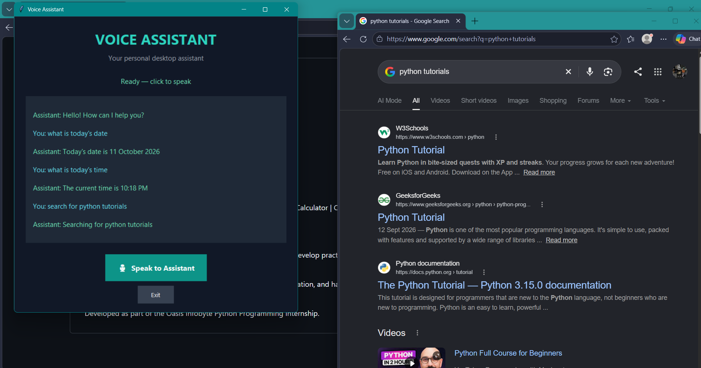
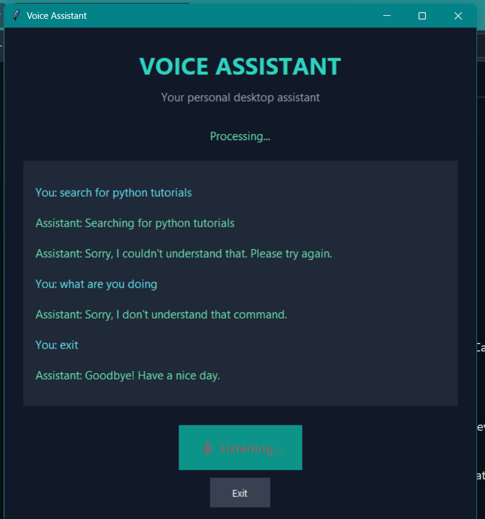

# Voice Assistant — Python Internship Task 1

## Project Overview

The Voice Assistant is a Python-based application developed as part of the Oasis Infobyte Python Programming Internship. It responds to user commands and performs basic tasks such as greeting the user, providing the current date and time, and opening web searches.

## Objectives

- Build a basic voice assistant using Python.
- Process user commands and respond appropriately.
- Provide date and time information.
- Open web searches based on user requests.
- Handle errors and unrecognized input gracefully.

## Features

- **Greeting:** Responds to a greeting from the user.
- **Date and Time:** Provides the current date and time.
- **Web Search:** Opens a browser search for a requested topic.
- **Error Handling:** Handles unrecognized input and unsuccessful interactions.
- **Speech Output:** Provides spoken responses using Windows text-to-speech.

## Technologies Used

- Python 3
- Speech recognition
- Date and time handling
- Web browser integration
- Windows PowerShell text-to-speech

## Project Structure

```text
Python-Task1-VoiceAssistant/
├── assistant.py
├── requirements.txt
└── README.md
```

## How to Run

1. Install Python 3 on your system.
2. Open the project folder in VS Code.
3. Install the dependencies listed in `requirements.txt`, if required.
4. Run the following command in the terminal:

```bash
python assistant.py
```

5. Follow the prompts and try the supported commands.

## Testing

The application was tested with greeting, date and time requests, web searches, unrecognized input, and exit commands.

## Learning Outcomes

- Working with Python libraries.
- Processing user commands.
- Handling errors and unexpected input.
- Integrating browser functionality.
- Implementing spoken output on Windows.

## Acknowledgement

This project was completed as part of the **Oasis Infobyte Python Programming Internship**.

## Screenshots

### Voice Assistant — Test 1



### Voice Assistant — Test 2

