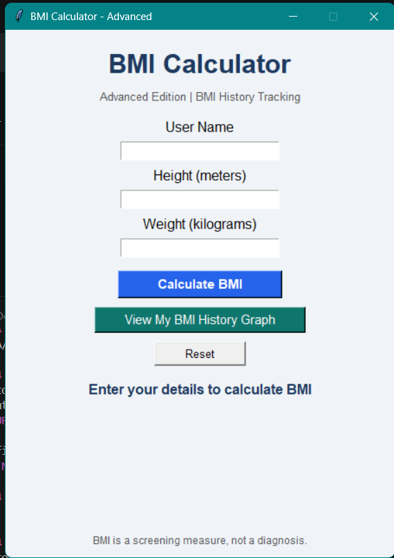
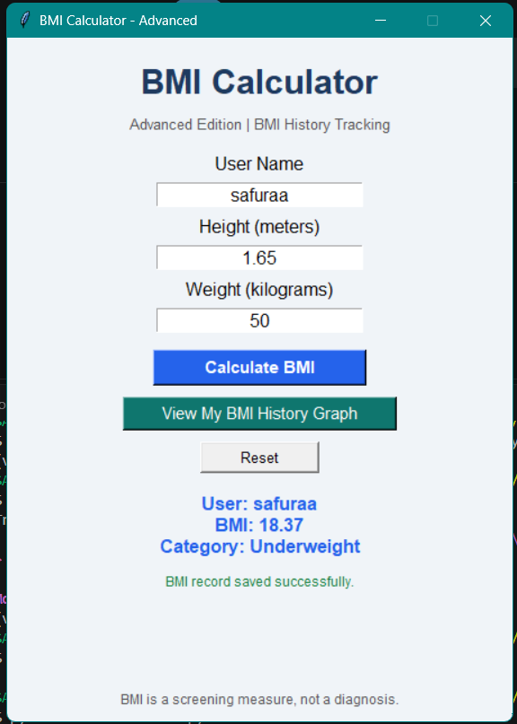
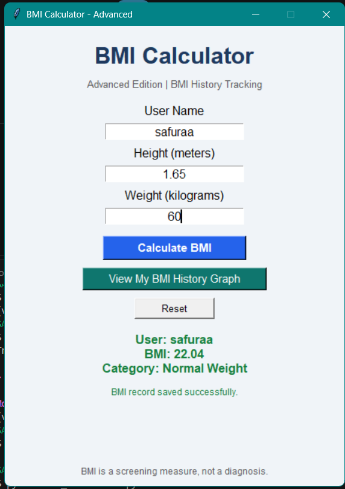
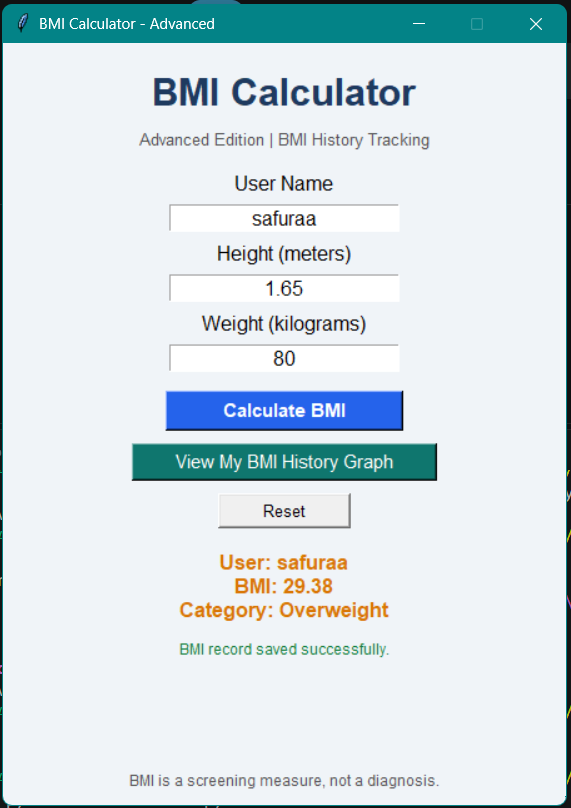
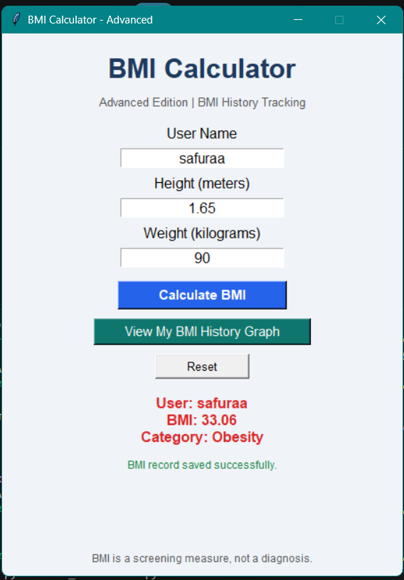
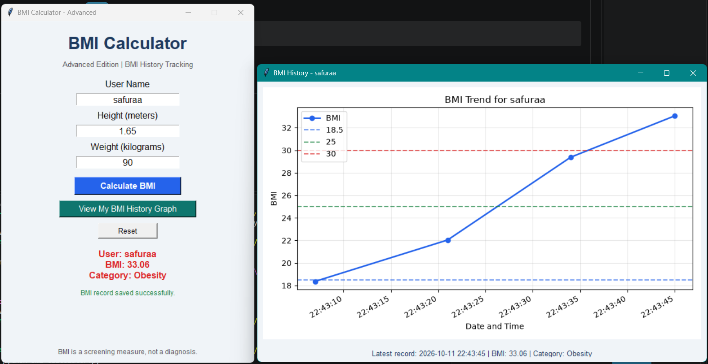
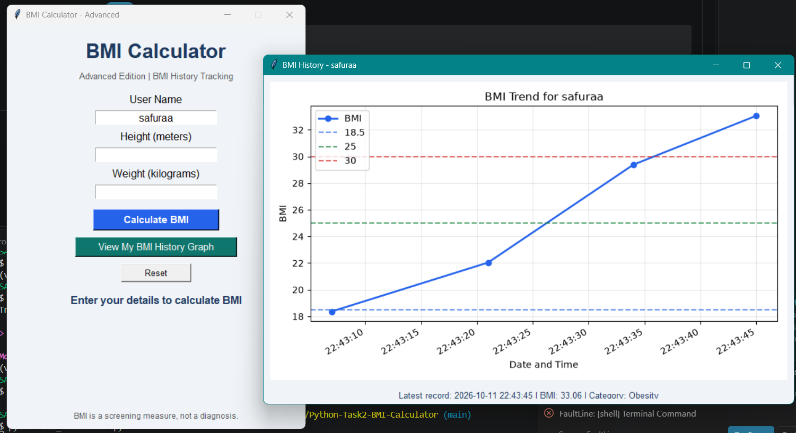

# BMI Calculator — Python Internship Task 2

## Project Overview

The BMI Calculator is a Python-based application developed as part of the Oasis Infobyte Python Programming Internship. It calculates a user's Body Mass Index (BMI) using their height and weight and displays the corresponding BMI result.

The project demonstrates fundamental Python programming concepts and provides practical experience in developing, executing, and documenting a Python application.

## Objectives

- Develop a BMI Calculator using Python.
- Calculate Body Mass Index from user-provided height and weight.
- Display the calculated BMI result.
- Practice Python programming and application testing.

## Features

- Accepts height and weight inputs.
- Calculates Body Mass Index (BMI).
- Displays the calculated BMI result.
- Includes a collection of screenshots demonstrating program execution.

## Technologies Used

- **Programming Language:** Python
- **Database:** SQLite (as indicated by the project's `bmi_history.db` file)
- **Additional Dependencies:** Refer to `requirements.txt`.

## Project Structure

```text
Python-Task2-BMI-Calculator/
├── images/
│   ├── bmi-calculator-test1.png
│   ├── bmi-calculator-test2.png
│   ├── bmi-calculator-test3.png
│   ├── bmi-calculator-test4.png
│   ├── bmi-calculator-test5.png
│   ├── bmi-calculator-test6.png
│   └── bmi-calculator-test7.png
├── bmi_calculator.py
├── bmi_history.db
├── requirements.txt
└── README.md
```

## Installation and Execution

1. Install Python on your system if it is not already installed.
2. Clone or download this repository.
3. Open a terminal in the project directory.
4. Install the required dependencies:

   ```bash
   pip install -r requirements.txt
   ```

5. Run the application:

   ```bash
   python bmi_calculator.py
   ```

6. Follow the program prompts and enter the required values.

## Screenshots

### Test 1


### Test 2


### Test 3


### Test 4


### Test 5


### Test 6


### Test 7


## Learning Outcomes

- Practiced Python programming and user input handling.
- Applied mathematical calculations in a practical application.
- Gained experience testing a Python program.
- Practiced project organization and technical documentation using Markdown.

## Acknowledgement

This project was completed as part of the **Oasis Infobyte Python Programming Internship**.

---

*Developed for learning and practical application of Python programming concepts.*
