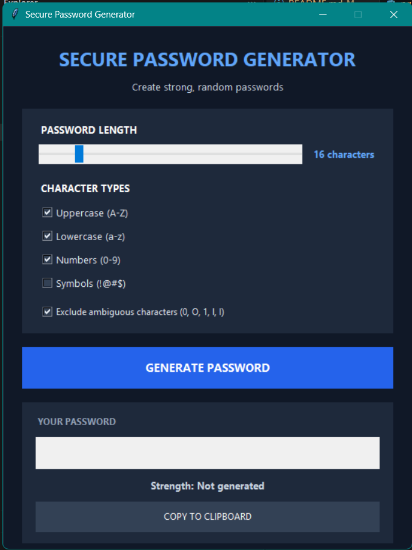
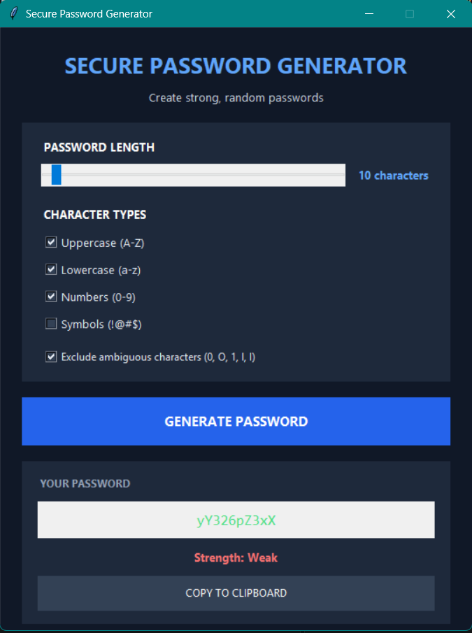
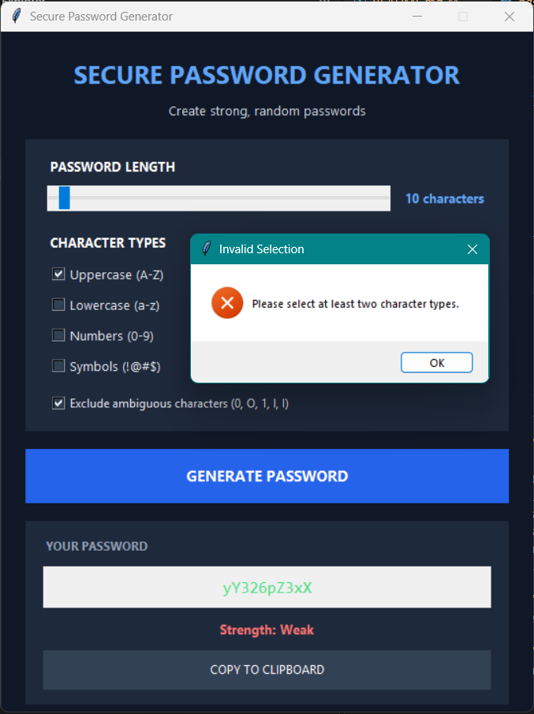
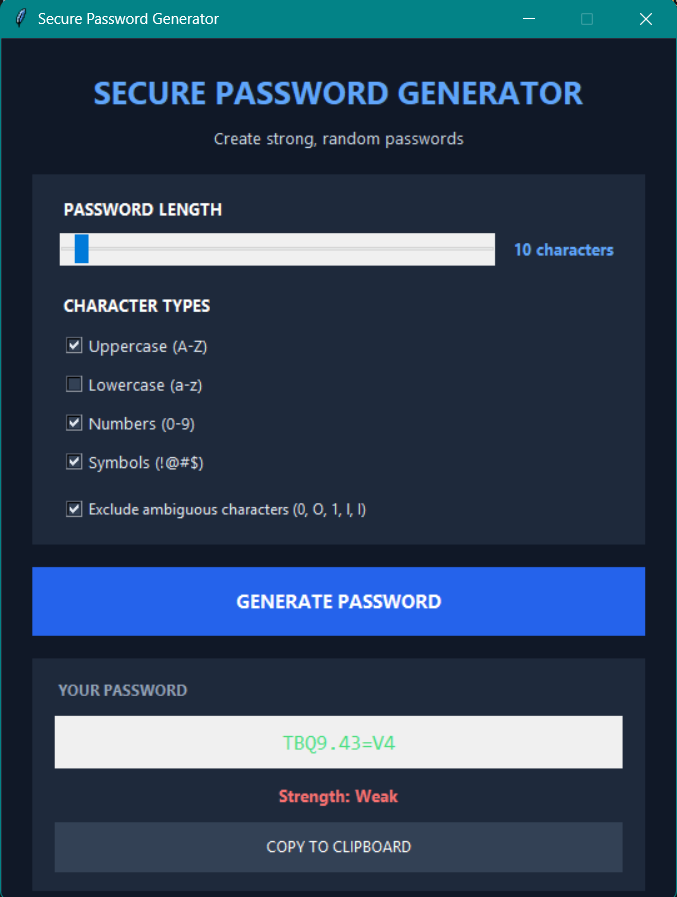
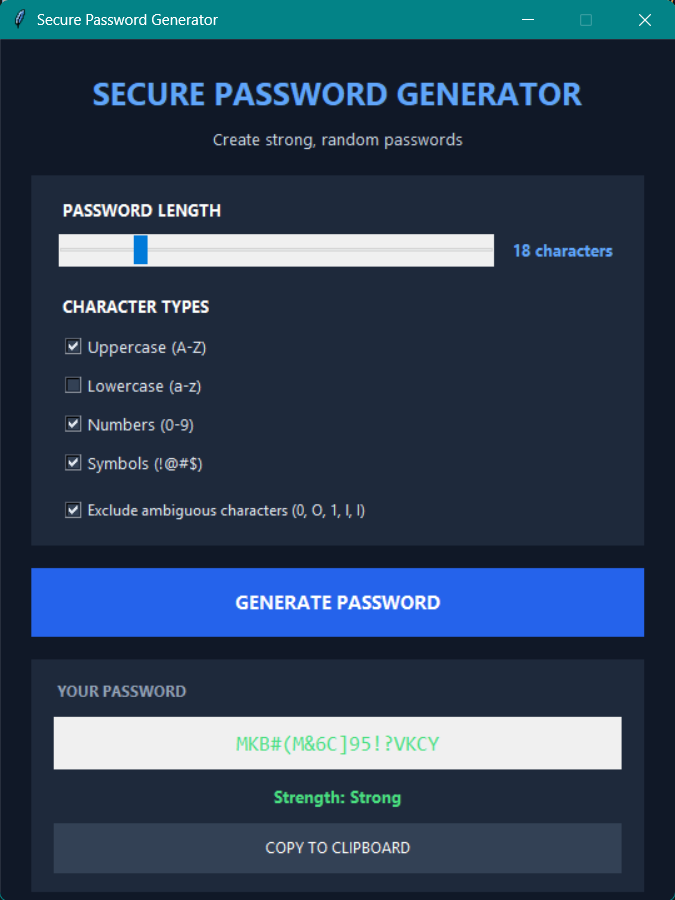
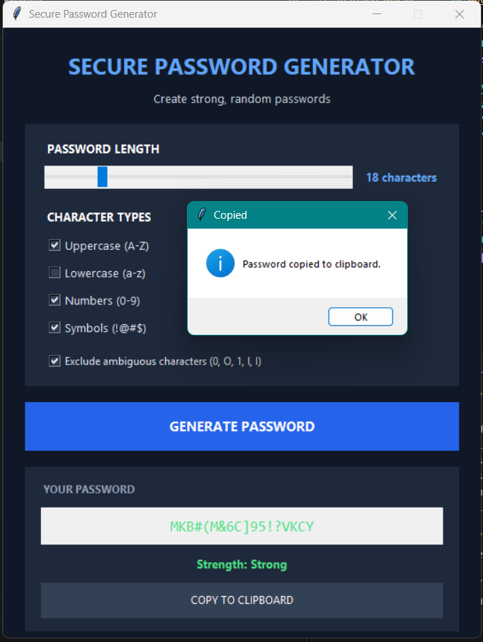

# Random Password Generator — Python Internship Task 3

## Project Overview

The Random Password Generator is a Python-based application developed as part of the Oasis Infobyte Python Programming Internship. It generates random passwords and demonstrates the practical application of Python programming concepts.

## Objectives

- Develop a password generator using Python.
- Generate random passwords through the application.
- Practice Python programming and randomization.
- Test the application with different inputs.

## Features

- Random password generation.
- Interactive command-line interface.
- Password generation testing, as demonstrated in the screenshots.

## Technologies Used

- **Programming Language:** Python
- **Dependencies:** Refer to `requirements.txt`.

## Project Structure

```text
Python-Task3-RandomPasswordGenerator/
├── images/
│   ├── password-generator-test1.png
│   ├── password-generator-test2.png
│   ├── password-generator-test3.png
│   ├── password-generator-test4.png
│   ├── password-generator-test5.png
│   └── password-generator-test6.png
├── password_generator.py
├── requirements.txt
└── README.md
```

## Installation and Execution

1. Install Python on your system.
2. Clone or download the repository.
3. Open a terminal in the project directory.
4. Install dependencies, if required:

   ```bash
   pip install -r requirements.txt
   ```

5. Run the application:

   ```bash
   python password_generator.py
   ```

6. Follow the on-screen instructions to generate passwords.

## Screenshots

### Test 1


### Test 2


### Test 3


### Test 4


### Test 5


### Test 6


## Learning Outcomes

- Practiced Python programming and randomization.
- Gained experience running and testing a Python application.
- Learned to organize project files and document software using Markdown.

## Acknowledgement

This project was completed as part of the **Oasis Infobyte Python Programming Internship**.

---

*Developed for learning and practical application of Python programming concepts.*
