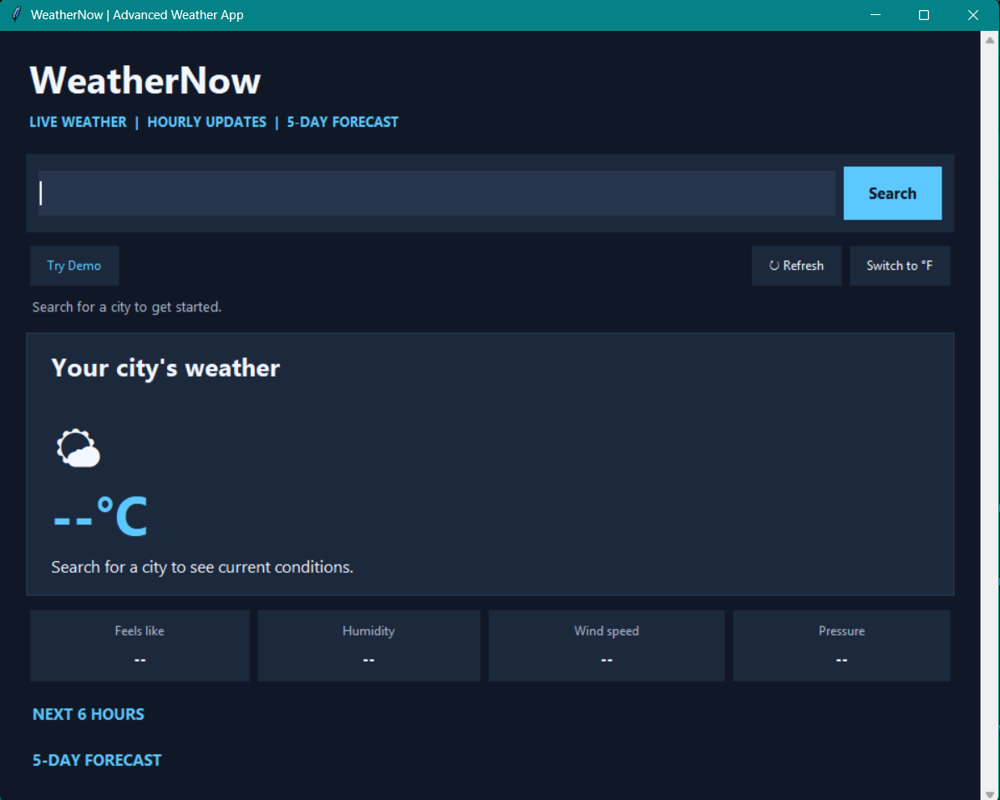
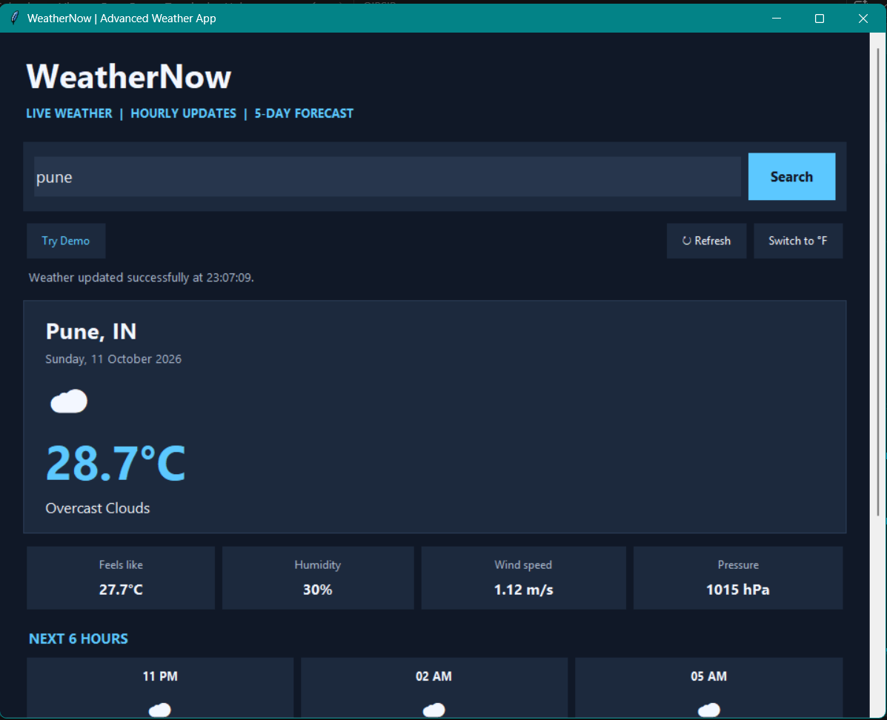
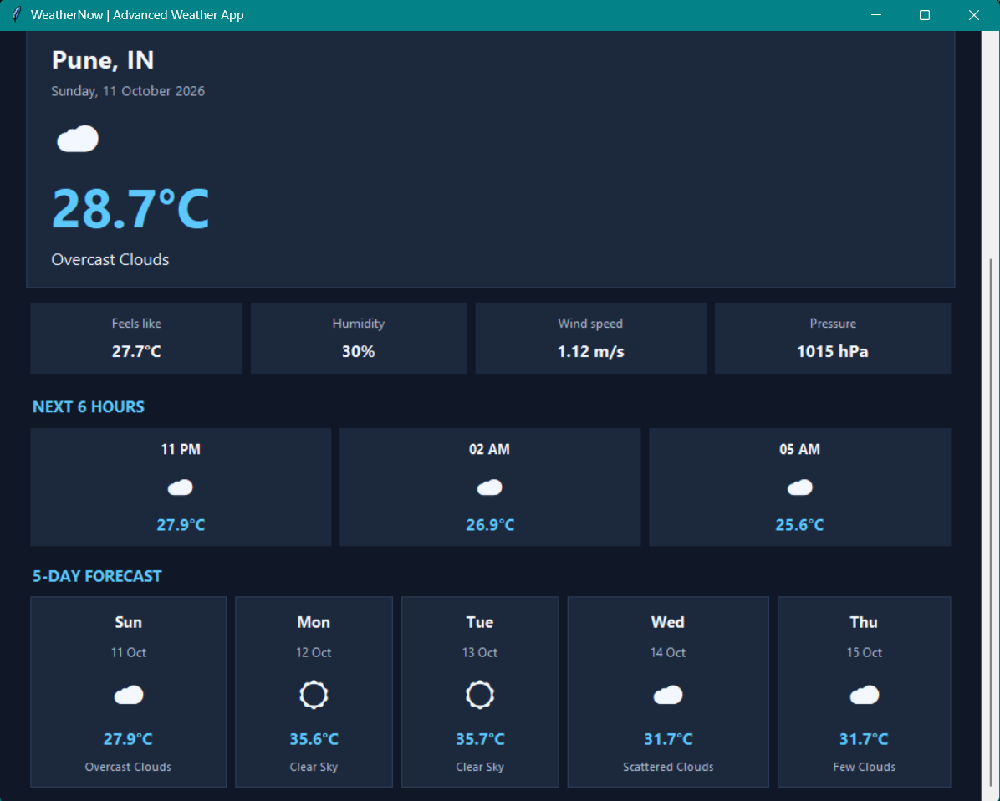
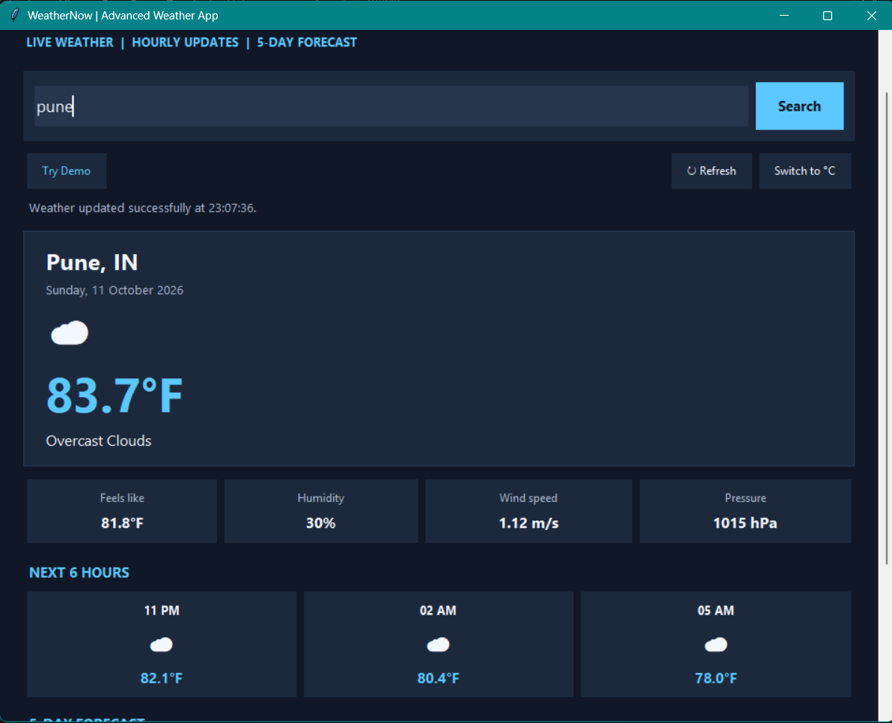
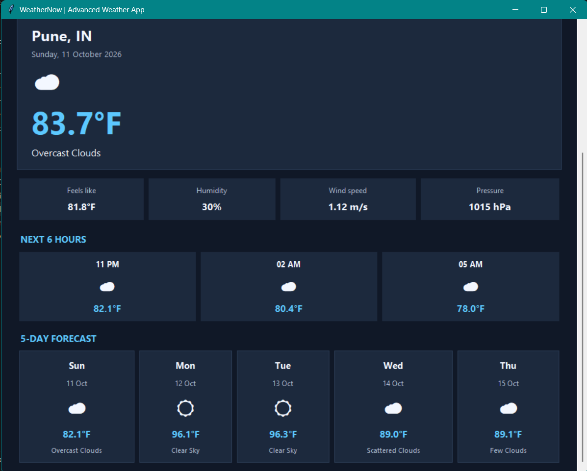
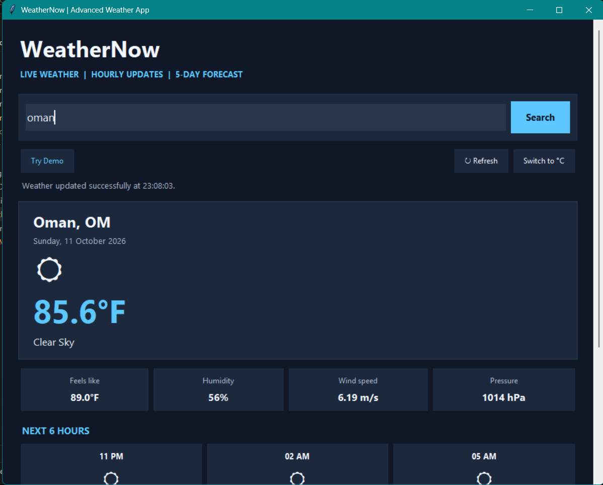
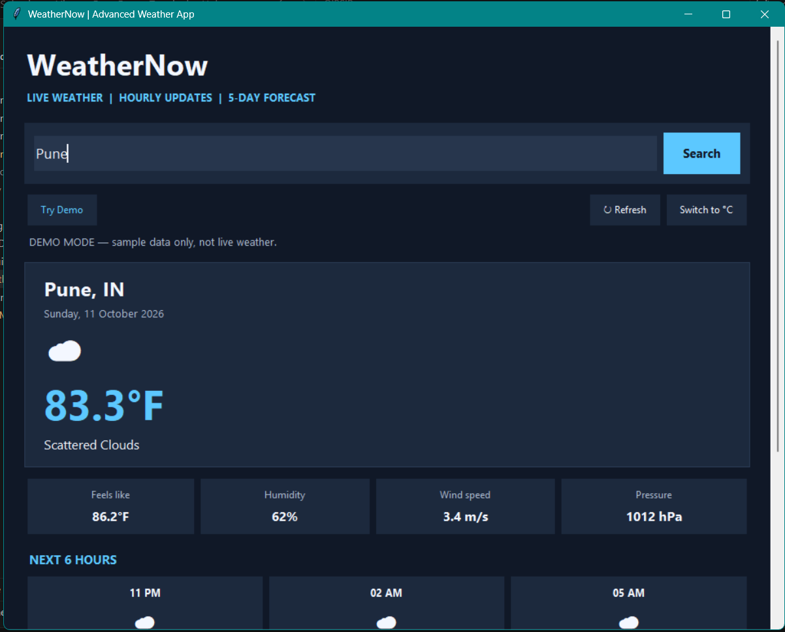
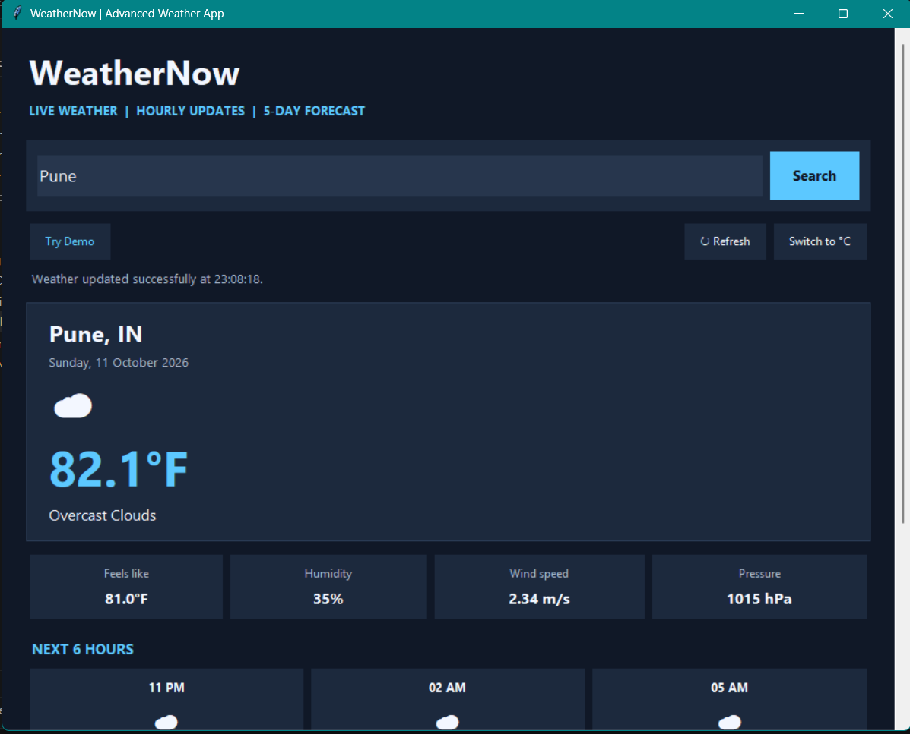

# Basic Weather App — Python Internship Task 4

## Project Overview

The Basic Weather App is a Python application developed as part of the Oasis Infobyte Python Programming Internship. It uses weather data from an external service to provide weather information for a city entered by the user.

## Objectives

- Develop a weather application using Python.
- Retrieve weather information using an external API.
- Practice working with Python libraries and environment variables.
- Test the application using different city inputs.

## Features

- Accepts a city name from the user.
- Retrieves weather information through a weather API.
- Uses environment variables to manage configuration.
- Provides a command-line interface for interaction.

## Technologies Used

- **Programming Language:** Python
- **HTTP Requests:** `requests`
- **Environment Configuration:** `python-dotenv`
- **Weather Data:** External weather API

## Project Structure

```text
Python-Task4-WeatherApp/
├── images/
│   ├── weather-app-test1.png
│   ├── weather-app-test2.png
│   ├── weather-app-test3.png
│   ├── weather-app-test4.png
│   ├── weather-app-test5.png
│   ├── weather-app-test6.png
│   ├── weather-app-test7.png
│   └── weather-app-test8.png
├── .env
├── .gitignore
├── requirements.txt
├── weather_app.py
└── README.md
```

## Installation and Execution

1. Install Python on your system.
2. Clone or download the repository.
3. Open a terminal in the project directory.
4. Install the required dependencies:

   ```bash
   python -m pip install -r requirements.txt
   ```

5. Configure the required weather API key in the `.env` file according to the application's configuration.
6. Run the application:

   ```bash
   python weather_app.py
   ```

7. Enter a city name and review the weather information returned by the application.

## Screenshots

### Test 1


### Test 2


### Test 3


### Test 4


### Test 5


### Test 6


### Test 7


### Test 8


## Learning Outcomes

- Practiced making HTTP requests in Python.
- Learned to manage configuration using environment variables.
- Gained experience integrating an external API.
- Practiced testing and documenting a Python application.

## Acknowledgement

This project was completed as part of the **Oasis Infobyte Python Programming Internship**.

---

*Developed for learning and practical application of Python programming concepts.*
